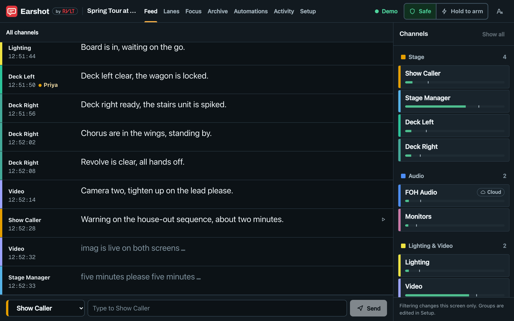

  

  <h1>Earshot</h1>
  
<strong>Live transcription for the crew behind the show.</strong>

  
Follow your comms channels on a desktop, phone or tablet. Speech recognition runs on your host computer.

  

    <a href="https://github.com/RVLT-Labs/earshot-releases/releases/latest"><strong>Download Earshot</strong></a>
    &nbsp;·&nbsp;
    <a href="https://rvlt-labs.github.io/earshot-manual/">Read the manual</a>
    &nbsp;·&nbsp;
    <a href="https://github.com/RVLT-Labs/earshot-releases/releases">Release notes</a>
    &nbsp;·&nbsp;
    <a href="https://rvlt-labs.github.io/earshot-manual/changelog">Changelog</a>
  

  
Built by <strong>RVLT</strong> for live-production crews.

---

*Demo show with sample transcript content.*

## Keep up with the conversation

Earshot turns speech from multiple audio channels into a live, readable transcript. Run it on the computer connected to your audio inputs, then let the crew follow along in a browser on the show network.

- **Read across channels.** Follow a combined Feed, arrange channels in Lanes, or use Focus for a larger view.
- **Catch your name.** Enter your name or keywords under **Display → Personal keyword alerts** to flash only your device and show the matching line. No automation or Armed mode is needed.
- **Bring the crew in.** Phones, tablets and laptops connect through a browser. Only the host needs the desktop app.
- **Recognise speech locally.** Download the speech models during setup, then run them on your host. Cloud speech and translation are optional and require you to enable them.
- **Find a line again.** Search the transcript archive, add markers and export transcripts.
- **Make it fit your show.** Organise channels into groups and add names and production terms to the glossary.
- **Connect show control.** Build phrase-triggered OSC, MIDI and HTTP actions, with Armed/Safe controls, a test bench and an activity log.

## Download

**[Get the latest release →](https://github.com/RVLT-Labs/earshot-releases/releases/latest)**

Packages below are for **v0.2.0**. Check the release notes before installing or updating.

| Your computer | Download |
|---|---|
| **macOS · Apple Silicon** | [DMG installer](https://github.com/RVLT-Labs/earshot-releases/releases/download/v0.2.0/Earshot_0.2.0_aarch64.dmg) |
| **Windows · 64-bit** | [EXE installer](https://github.com/RVLT-Labs/earshot-releases/releases/download/v0.2.0/Earshot_0.2.0_x64-setup.exe) · [MSI installer](https://github.com/RVLT-Labs/earshot-releases/releases/download/v0.2.0/Earshot_0.2.0_x64_en-US.msi) |
| **Linux · x86_64** | [AppImage](https://github.com/RVLT-Labs/earshot-releases/releases/download/v0.2.0/Earshot_0.2.0_amd64.AppImage) · [DEB](https://github.com/RVLT-Labs/earshot-releases/releases/download/v0.2.0/Earshot_0.2.0_amd64.deb) · [RPM](https://github.com/RVLT-Labs/earshot-releases/releases/download/v0.2.0/Earshot-0.2.0-1.x86_64.rpm) |

There is no Intel Mac build. Linux packages are built on Ubuntu 22.04. GitHub's **Source code** archives contain this downloads page and its images; install one of the packages above.

### Before you install

These early releases are **unsigned**. macOS may require approval in **System Settings → Privacy & Security**. Windows may show a SmartScreen warning. Read the release notes for instructions.

All three platforms have passed a headless startup check. The macOS packaged app has also been started and checked; the Windows and Linux installer interfaces and desktop windows have not yet been tested. Test your audio hardware and show setup before relying on it in production.

Each release includes [SHA256SUMS.txt](https://github.com/RVLT-Labs/earshot-releases/releases/download/v0.2.0/SHA256SUMS.txt) so you can verify your download.

## Your first session

1. **Install and open Earshot** on the computer connected to your audio inputs.
2. **Install the recommended speech models** in **Setup → Models** while you have internet access.
3. **Choose your inputs** in **Setup → Patch**, then check that speech appears in the Feed.
4. **Set access for your crew** in **Setup → Access** and share **Address for the crew**. They open it in a browser on the same network.

Keep the show **Safe** while setting up and testing automations. The manual covers access controls, model downloads, show control and the current limits.

**[Open the user manual →](https://rvlt-labs.github.io/earshot-manual/)**

---

This repository is the public home for Earshot installers, release notes and download information. The application source is maintained in a separate private repository.
